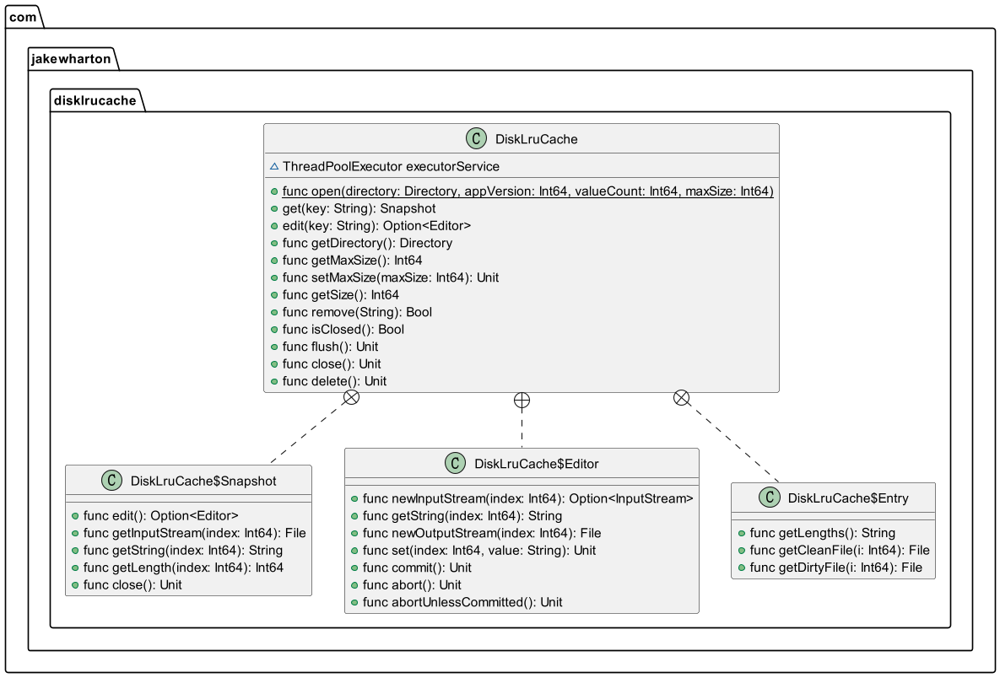

<div align="center">
<h1>diskLruCache4cj</h1>
</div>

<p align="center">


</p>

## 介绍

DiskLruCache 是一个管理硬盘内容的存储管理工具，它采用了最近最少使用（LRU）算法，以对硬盘中存储的文件进行管理，在存储空间短缺的情况下，会优先将最近最少使用的文件删除，以扩展可用的硬盘空间。

参考地址: https://github.com/JakeWharton/DiskLruCache 版本2.0.2

### 特性

- 🚀 支持数据写入硬盘缓存中

- 🚀 支持从硬盘缓存中读取数据

- 💪 支持从硬盘缓存中删除指定key值的缓存文件

- 🛠️ 支持同步缓存文件的操作记录至journal和关闭缓存


## 软件架构

### 架构图

<p align="center">

</p>


### 源码目录

```shell
.
├── README.md
├── doc
│   ├── assets
│   └── feature_api.md
├── src
│   └── disklrucache
├── test
│    ├── HLT
│    └── LLT
├── CHANGELOG.md
├── gitee_gate.cfg
├── LICENSE.txt
├── module.json
├── README.md
└── README.OpenSource
```

- `doc`  文档目录，用于存API接口文档
- `src`  是库源码目录
- `test` 存放 HLT 测试用例、LLT 自测用例

### 接口说明

主要类和函数接口说明详见 [API](./doc/feature_api.md)


## 使用说明

### 编译

```shell
cpm build
```

### 功能示例
#### 数据写入硬盘缓存中 功能示例


```cangjie
from disklrucache import disklrucache.*
from std import io.*
from std import fs.*
from std import os.posix.*
from std import unittest.*
from std import unittest.testmacro.*

main() {

    let lrucache = LruCacheOpen1Test()
    lrucache.open1Test()
    return 0
}

@Test
public class LruCacheOpen1Test {
    @TestCase
    public func open1Test(): Unit {

        var path: String = getcwd()
        var TmpDir = path + "/DiskLruCacheTest"
        let appVersion = 100
        var cacheDir = Directory.create(TmpDir) 
        var cache = DiskLruCache.open(cacheDir, appVersion, 2, Int64(Int32.Max))
        let key = "k1"
        let src = cache.edit(key).getOrThrow()
        src.set(0, "ABC")
        src.set(1, "DE")
        let pc = src.getString(0).isEmpty()
        src.commit()
        println("success")
        @Assert(true, pc)    
    }
}
```

执行结果如下：

```shell
success
```

#### 从缓存中读取数据 功能示例

```cangjie
from disklrucache import disklrucache.*
from std import io.*
from std import fs.*
from std import os.posix.*
from std import unittest.*
from std import unittest.testmacro.*

main() {

    let lrucache = LruCacheOpen1Test()
    lrucache.open1Test()
    return 0
}

@Test
public class LruCacheOpen1Test {
    @TestCase
    public func open1Test(): Unit {

        var path: String = getcwd()
        var TmpDir = path + "/DiskLruCacheTest37"
        let appVersion = 100
        var cacheDir = Directory.create(TmpDir) 
        var cache = DiskLruCache.open(cacheDir, appVersion, 2, Int64(Int32.Max))
        let key = "k1"
        let src = cache.edit(key).getOrThrow()
        src.set(0, "OP")
        src.set(1, "LKll")
        src.commit()
        let sc = cache.get("k1").getOrThrow().getString(0)
        println("success")
        @Assert("OP", sc)
    }
}
```

执行结果如下：

```shell
success
```

#### 缓存中删除指定key值的缓存文件 功能示例

```cangjie
from disklrucache import disklrucache.*
from std import io.*
from std import fs.*
from std import os.posix.*
from std import unittest.*
from std import unittest.testmacro.*

main() {

    let lrucache = LruCacheOpen1Test()
    lrucache.open1Test()
    return 0
}

@Test
public class LruCacheOpen1Test {
    @TestCase
    public func open1Test(): Unit {

        var path: String = getcwd()
        var TmpDir = path + "/DiskLruCacheTest"
        let appVersion = 100
        var cacheDir = Directory(TmpDir) 
        var cache = DiskLruCache.open(cacheDir, appVersion, 2, Int64(Int32.Max))
        let key = "k1"
        let src = cache.edit(key).getOrThrow()
        src.set(0, "ABC")
        src.set(1, "DE")
        let pc = src.getString(0).isEmpty()
        src.commit()
        let cq = cache.remove("k1")
        println("success")
        @Assert(true, cq)    
    }
}
```

执行结果如下：

```shell
success
```

#### 同步缓存文件的操作记录至journal和关闭缓存 功能示例

```cangjie
from disklrucache import disklrucache.*
from std import io.*
from std import fs.*
from std import os.posix.*
from std import unittest.*
from std import unittest.testmacro.*

main() {

    let lrucache = LruCacheOpen1Test()
    lrucache.open1Test()
    return 0
}

@Test
public class LruCacheOpen1Test {
    @TestCase
    public func open1Test(): Unit {

        var path: String = getcwd()
        var TmpDir = path + "/DiskLruCacheTest"
        let appVersion = 100
        var cacheDir = Directory.create(TmpDir)
        var cache = DiskLruCache.open(cacheDir, appVersion, 2, Int64(Int32.Max))
        let src = cache.close()
        let src1 = cache.isClosed()
        println("success")
        @Assert(true, cache.isClosed())

    }
}
```

执行结果如下：

```shell
success
```

## 开源协议
Apache License 2.0

## 参与贡献

欢迎给我们提交PR，欢迎给我们提交Issue，欢迎参与任何形式的贡献。